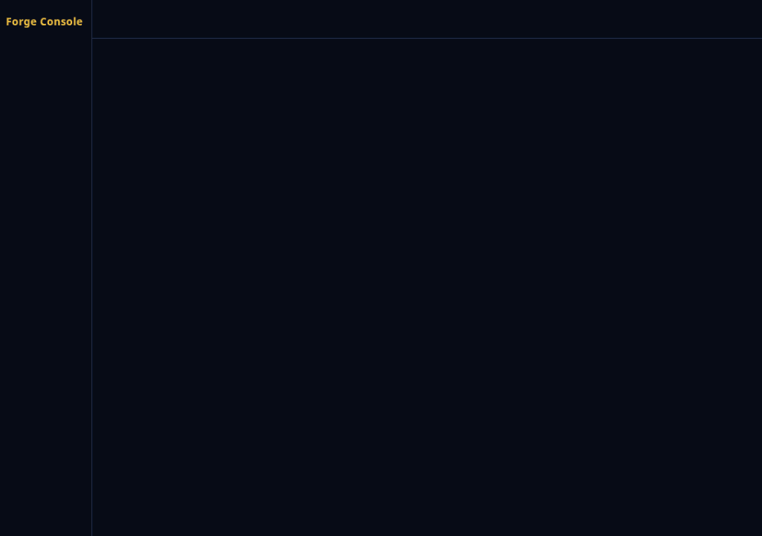

# MyForge

[](LICENSE)
[](https://en.wikipedia.org/wiki/Bash_(Unix_shell))
[](https://learn.microsoft.com/powershell/)

> **Copilot app edition: planning only.** This repository contains a fresh
> MyForge source baseline and a [multi-phase implementation plan](docs/copilot-app/IMPLEMENTATION-PLAN.md)
> with [execution evidence tracking](docs/copilot-app/evidence/README.md).
> No app plugin or app-native engine has been implemented. The standalone
> overview and commands below describe the inherited MyForge baseline.

> MyForge turns an idea into a reviewed PRD, a specialist agent team, and an autonomous build.

**Latest: v3.131** — see [docs/updates.md](docs/updates.md) for release notes.

## Table of Contents

[About](#about) · [Features](#features) · [Tech Stack](#tech-stack) ·
[Architecture](#architecture) · [Project Structure](#project-structure) ·
[Getting Started](#getting-started) · [Configuration](#configuration) ·
[Security](#security) · [How to Contribute](#how-to-contribute) ·
[What's Next](#whats-next) · [License](#license) ·
[Acknowledgements](#acknowledgements) · [Author](#author)

## About

MyForge is a PRD-first workflow for turning product requirements into working software. It combines structured planning, agent-based implementation, and execution orchestration in one path so a project can move from concept to build without losing the review checkpoints that matter.

Every solution uses a PRD and one or more canonical feature documents.
Requirements and tasks have one owning location; compact task contracts resolve
shared IDs into complete execution instructions. Legacy source documents must be
converted before building. See [Canonical Features](docs/canonical-features.md).

Generated agents can declare relevant project procedures with
[agent-to-skill associations](docs/agent-skill-associations.md). The same
design is documented as a [portable pattern](docs/patterns/agent-skill-associations.md)
for projects that do not use MyForge.

## Features

- Keeps the PRD as the quality gate before implementation begins.
- Generates a specialist agent team from the PRD instead of relying on a single generic assistant.
- Supports both guided, interactive execution and unattended "dark orchestration" runs.
- Includes a local web console for monitoring and controlling builds.
- Can bootstrap MyForge into an existing Git repository without replacing its application code.
- Can retire the Forge lifecycle when the build is done, keeping the generated agents as a repository-derived support team.


[](docs/showcase/README.md)

See the [showcase gallery](docs/showcase/README.md) or the
[Forge Console visual tour](docs/forge-console-screenshots.md) for the full
screenshot walkthrough, including current responsive captures.


## Tech Stack

The standalone launcher, compiler and engine are TypeScript/Node.js packages;
the Console serves a local web interface. Git and a configured agent harness
support repository execution. See the [administrator guide](docs/admin-guide.md).

## Architecture

The launcher handles intake; the execution adapter compiles the manifest; the
workflow engine schedules and verifies tasks; the Console projects state and
controls. See [architecture](ARCHITECTURE.md) and the [ADR index](docs/adr/README.md).

## Project Structure

- `scripts/forge-launcher/` — launcher and Console.
- `templates/skills/` and `templates/agents/` — bootstrapped tooling and agents.
- `docs/` — guides, change history, decisions and app-edition plans.

<a id="quick-start"></a>
## Getting Started

### Prerequisites

- Node.js 20.12+ for the locked launcher dependencies (the launcher manifest
  still declares 18+)
- Git
- A compatible agent harness such as GitHub Copilot, Claude Code, or opencode

### Option 1: Run from a clone

```bash
git clone https://github.com/McFuzzySquirrel/MyForge-copilot-app.git
cd MyForge-copilot-app
cd scripts/forge-launcher
npm install
npm run build
node dist/cli.js
```

The shell wrapper delegates to the built Node package and remains available for
compatibility with existing workflows. To run the package directly instead,
use `node dist/cli.js` from `scripts/forge-launcher`.

### Option 2: Install the npm package from source

The npm package is not published yet, but the current pre-release is
`forge-launcher@1.0.0-beta.6`. You can install it locally from this repository:

```bash
git clone https://github.com/McFuzzySquirrel/MyForge-copilot-app.git
cd MyForge-copilot-app/scripts/forge-launcher
npm install
npm pack
npm install -g ./forge-launcher-1.0.0-beta.6.tgz
```

If npm 11 warns about unapproved install scripts, rerun the install with
explicit approval for the two required packages:

```bash
npm install -g --allow-scripts=node-pty,esbuild ./forge-launcher-1.0.0-beta.6.tgz
```

This approves only those packages for this install. The package's
`allowScripts` field does not set npm's global approval policy. To remember the
approval for future global installs, run
`npm config set allow-scripts=node-pty,esbuild --location=user` once instead;
that setting applies to future global installs for your user.

Once installed, run:

```bash
forge-launcher
```

The launcher walks you through repo bootstrap, idea capture, PRD drafting, team generation, and build execution. The Console also supports bootstrapping an existing repository and adding Feature PRDs to completed projects.

For the manual prompting flow and the CLI’s expected prompts, see [docs/prompt-playbook.md](docs/prompt-playbook.md). For the latest changes and release notes, see [docs/updates.md](docs/updates.md).

> [!NOTE]
> The canonical launcher runtime lives in [scripts/forge-launcher](scripts/forge-launcher). The shell wrappers are compatibility shims for existing workflows.

## Configuration

The Console defaults to local port `4300`; engine concurrency defaults to one
task. See the [administrator guide](docs/admin-guide.md#configuration) and
[launcher reference](docs/forge-launcher.md) for flags and environment variables.

## Security

Use trusted workspaces and protect credentials and logs. The standalone
Copilot engine adapter defaults to `--yolo`; the Console token is not user
authentication. See [security guidance](docs/admin-guide.md#security-and-privacy-checklist).
Report suspected vulnerabilities privately to the repository maintainer.

## How it works

1. Capture your idea and review the PRD.
2. Generate the agent team and any model plan.
3. Run the build interactively or unattended.
4. Retire the requirements and execution scaffolding when the project is done;
   the generated specialists continue as a maintenance team.

## Main components

- `forge-launcher` - the entry point for onboarding, authoring, and launching builds
- `forge-workflow-engine` - the execution engine for orchestration, checkpoints, replay, and state
- `forge-execution-adapter` - compiles the authored plan into the execution manifest consumed by the workflow engine
- `forge-retire-project` - retires the build lifecycle and rewrites the generated agents as a repository-derived support team
- Native harness adapters - dispatch execution through Copilot, OpenCode, OpenAI text tasks, or the offline stub
- Forge Console - a local web UI for authoring, monitoring, and controlling runs

## Documentation

- [User guide](docs/user-guide.md)
- [Administrator guide](docs/admin-guide.md)
- [Architecture decision index](docs/adr/README.md)
- [v3.131 draft release notes](docs/releases/v3.131.md)
- [docs/task-contracts.md](docs/task-contracts.md)
- [docs/forge-launcher.md](docs/forge-launcher.md)
- [docs/forge-console.md](docs/forge-console.md)
- [docs/forge-console-user-guide.md](docs/forge-console-user-guide.md)
- [docs/workflow-engine.md](docs/workflow-engine.md)
- [docs/workflow-engine-deep-dive.md](docs/workflow-engine-deep-dive.md)
- [docs/artifact-store-deep-dive.md](docs/artifact-store-deep-dive.md)
- [docs/research/myforge-agentic-development-value-chain.md](docs/research/myforge-agentic-development-value-chain.md)
- [docs/THE-STORY.md](docs/THE-STORY.md)
- [docs/THE-STORY-PART-2.md](docs/THE-STORY-PART-2.md)
- [docs/THE-STORY-PART-3.md](docs/THE-STORY-PART-3.md)
- [docs/THE-STORY-PART-4.md](docs/THE-STORY-PART-4.md)
- [docs/THE-STORY-PART-5.md](docs/THE-STORY-PART-5.md)
- [docs/THE-STORY-PART-6.md](docs/THE-STORY-PART-6.md)
- [docs/prompt-playbook.md](docs/prompt-playbook.md)
- [docs/updates.md](docs/updates.md)
- [ARCHITECTURE.md](ARCHITECTURE.md)
- [CONTRIBUTING.md](CONTRIBUTING.md)

## Development

```bash
cd scripts/forge-launcher
npm install
npm test
npm run typecheck
```

## How to Contribute

See [CONTRIBUTING.md](CONTRIBUTING.md) for setup, checks and review expectations.

## What's Next

The [Copilot app edition](docs/copilot-app/IMPLEMENTATION-PLAN.md) is planned
for Linux first. Its app-native execution and recovery remain unproven; Windows
and macOS are deferred to a possible v2.

## License

The repository includes an [MIT license](LICENSE). The launcher package manifest
currently declares ISC; this metadata discrepancy needs maintainer review.

## Acknowledgements

The standalone source baseline was imported from
[mcfuzzy-agent-forge](https://github.com/McFuzzySquirrel/mcfuzzy-agent-forge);
see the [source provenance](docs/copilot-app/IMPLEMENTATION-PLAN.md#source-baseline-and-boundaries).

## Author

Maintained by [McFuzzySquirrel](https://github.com/McFuzzySquirrel). Use the
[issue tracker](https://github.com/McFuzzySquirrel/MyForge-copilot-app/issues)
for questions and bug reports.
